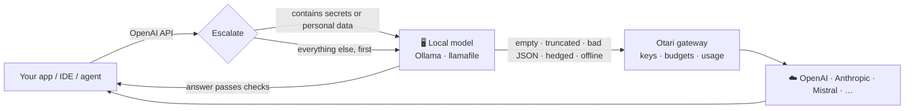

<div align="center">

# Escalate

**Local first. Cloud only when it counts. Secrets never leave your machine.**

A drop-in, OpenAI-compatible router that answers with a model on your laptop and escalates to the cloud through [Mozilla.ai's Otari gateway](https://github.com/mozilla-ai/otari) only when the local answer isn't good enough.

[](https://github.com/BernardOnuh/escalate/actions/workflows/test.yml)


[](LICENSE)

*Built for **MozFest 2026 · Developers Wilding: Online** (the Mozilla Otari hackathon)*

</div>

---

## The problem

Most of the AI traffic a developer generates is small: commit messages, regexes, renames, "what does this error mean?". A 3B model running on a laptop handles that fine. Yet almost all of it goes to a frontier model in someone else's cloud, which means:

- 💸 **Paying frontier prices for trivial work.**
- 🔓 **Leaking code, API keys and customer data** to whichever provider is behind the request.
- 🔒 **Locking yourself into one vendor's endpoint.**

## The idea

Escalate sits between your tools and the models. It gives every request to your **local model first**, checks the answer, and escalates to the cloud only when it has to. The cloud path goes through **Otari**, so escalations get one key for many providers, a **hard budget cap** and usage tracking.



| Situation | Where it goes |
|---|---|
| Local answer passes the checks | 🖥️ **Local**: free, fast, private |
| Local answer is empty, truncated, invalid JSON, or hedged ("I'm not sure…") | ☁️ **Escalated** through Otari |
| Local model is offline | ☁️ **Escalated** through Otari |
| Prompt contains an API key, private key, password, JWT, email address or card number | 🔒 **Always local**, even if the client explicitly asks for the cloud. If the local model is down, the request is **refused rather than leaked**. |

## 30-second demo

No Docker, no model download, no dependencies, only Python 3.9+:

```bash
git clone https://github.com/BernardOnuh/escalate && cd escalate
python3 escalate.py --mock      # starts a mock local model + mock Otari gateway
python3 bench.py                # in a second terminal
```

Then open **http://127.0.0.1:8787** for the live dashboard: the share of requests served locally, dollars saved against an all-cloud setup, Otari spend, private prompts kept on-device, and the reason behind every routing decision.

```
local 200  Write a one-line commit message for: fixed typo in README   local answer passed checks
local 200  Give me a regex that matches a US zip code.                 local answer passed checks
cloud 200  Return nested JSON listing items with name and tags.        escalated: invalid JSON
cloud 200  Design a distributed rate limiter and explain the trade-of  escalated: model hedged
local 200  Debug this config: OPENAI_KEY=sk-proj-abcdefghijklmnopqrst  private: API key
local 200  Design a distributed cache for user sessions. Customer: bo  private: email address
...
16 requests: 12 local (75%), 4 cloud, 0 errors, 4 private prompts kept on-device
```

> `--mock` uses stand-in models so anyone can see the routing in seconds. For real answers, follow the setup below.

## Real setup

**1. Run a local model.** Any OpenAI-compatible server works.

```bash
# Ollama
ollama pull llama3.2:3b && ollama serve            # → http://localhost:11434/v1
# or Mozilla's llamafile
./Llama-3.2-3B-Instruct.llamafile --server         # → http://localhost:8080/v1
```

**2. Run Otari.**

```bash
docker run -v otari:/data -p 127.0.0.1:8000:8000 mzdotai/otari:latest
```

Open the setup link it prints and add a provider (for example OpenAI). Create an API key (`tk-…`) and **give it a budget**. That budget is the hard ceiling on what escalations can ever cost.

**3. Start Escalate.**

```bash
export OTARI_API_KEY=tk-...
export CLOUD_MODEL=openai:gpt-4o-mini                # any provider:model Otari supports
export LOCAL_MODEL=llama3.2:3b
# export LOCAL_BASE_URL=http://localhost:8080/v1     # if you use llamafile
python3 escalate.py
```

**4. Point your tools at it.** Anything that speaks the OpenAI API works without changes:

```python
from openai import OpenAI

client = OpenAI(base_url="http://127.0.0.1:8787/v1", api_key="unused")
client.chat.completions.create(
    model="auto",
    messages=[{"role": "user", "content": "Write a commit message for my diff"}],
)
```

## Routing controls

Set the `model` field, or the `X-Escalate` header, to one of these:

| Mode | Behaviour |
|---|---|
| `auto` *(default)* | Local first, escalate on a weak answer |
| `local` | Never touch the cloud |
| `cloud` | Skip the local model. Sensitive prompts **still** stay local. |

Every response includes `X-Escalate-Route` (`local` · `cloud` · `error`) and `X-Escalate-Reason`, so your tooling can see why each request went where it did.

## Why Otari

Escalate decides **whether** a request leaves your machine, and Otari governs **what happens when it does**:

- **One key, many providers.** Switch `CLOUD_MODEL` from `openai:…` to `anthropic:…` or `mistral:…` with no code changes.
- **Budgets.** Otari enforces spend limits before dispatch, so a misbehaving agent can't run up a bill through escalations.
- **Usage and audit.** Every escalation shows up in Otari's dashboard. If Otari rejects a request (over budget or bad key), Escalate passes its error straight through.

Together they form a fully open, self-hostable AI stack: your model, your gateway, your rules.

## Configuration

| Env var | Default | |
|---|---|---|
| `ESCALATE_PORT` | `8787` | Port for the proxy and dashboard |
| `LOCAL_BASE_URL` | `http://localhost:11434/v1` | Local OpenAI-compatible server |
| `LOCAL_MODEL` | `llama3.2:3b` | Local model name |
| `OTARI_BASE_URL` | `http://localhost:8000/api/v1` | Otari gateway |
| `OTARI_API_KEY` | none | Otari key (`tk-…`), required for escalation |
| `CLOUD_MODEL` | `openai:gpt-4o-mini` | Model used for escalations |
| `CLOUD_PRICE_IN` / `CLOUD_PRICE_OUT` | `0.15` / `0.60` | USD per 1M tokens, for the savings estimate |
| `ESCALATE_TIMEOUT` | `120` | Upstream timeout in seconds |

## API

| Endpoint | |
|---|---|
| `POST /v1/chat/completions` | The OpenAI-compatible proxy |
| `GET /v1/models` | Lists `auto`, `local`, `cloud` |
| `GET /` | Live dashboard |
| `GET /stats` | Counters and the last 50 routing decisions as JSON |
| `POST /stats/reset` | Reset counters |

## Tests

```bash
python3 -m unittest -v
```

There are 17 tests. They cover secret detection (including checks that ordinary developer prompts are *not* flagged), every quality check, and the full proxy end to end against the mock backends: escalation, forced routes, the local model going offline, Otari rejecting a request, and the guarantee that a secret is refused rather than sent to the cloud. CI runs them on Python 3.9 and 3.12.

## Project layout

```
escalate.py        the router: routing, privacy guard, quality checks, stats, HTTP server
dashboard.html     live dashboard served at /
bench.py           16-prompt developer workload for demos
mock_backends.py   mock local model + mock Otari gateway (used by --mock and tests)
test_escalate.py   test suite
```

## Limitations and roadmap

- **No streaming yet.** Responses come back in one piece. Streaming the local answer while checking it is next.
- **Heuristic quality checks.** Planned: a tiny local judge model and log-prob confidence scoring.
- **Regex-based privacy guard.** Treat it as a safety net, not a guarantee. Planned: per-path rules (for example, "never send `src/billing/**`").
- **Estimated savings.** Locally served tokens are priced at the cloud model's rate.
- **Planned: Otari usage sync**, pulling real per-key spend from Otari's API into the dashboard.

## License

[Apache 2.0](LICENSE)
